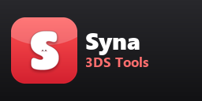

# Cement



Fast file transfers between a PC and a Nintendo 3DS, over Wi-Fi.

- **3DS app** (`Cement.cia` or `Cement.3dsx`): an FTP server for the SD card, with a CIA installer on the bottom screen.
- **Windows app** (`Cement.exe`): a file explorer for the 3DS with drag and drop, resumable transfers and Send to PC.
- **Command line** (`cement-cli`, Windows and Linux): everything from a terminal or a script, with JSON output.

## Download

Get the latest release on the [Releases](../../releases) page:

| File | What it is |
| --- | --- |
| `Cement.cia` | The 3DS app, to install with FBI or Cement itself (HOME menu icon) |
| `Cement.3dsx` | The same app for the Homebrew Launcher: put it in `/3ds/` on the SD card (for example `/3ds/Cement/Cement.3dsx`) |
| `Cement-windows.zip` | `Cement.exe` (explorer) and `cement-cli.exe` (command line), Windows 10/11 x64 |
| `Cement-linux-x86_64.zip` | `cement-cli` for Linux x86_64 |

## The 3DS app

Start Cement on the 3DS: the top screen shows the IP address and port (5000) to enter on the PC.

- **SD card only.** The server exposes the SD card and nothing else; paths can't leave it.
- **Fast.** Received data is written to the SD card by a separate thread while the next data is already
  arriving. On a New 3DS it switches to 804 MHz with the L2 cache on while transferring or installing
  (back to normal speed a few seconds after), and StreetPass/SpotPass are paused while it serves so they
  don't use the Wi-Fi radio.
- **Battery.** Closing the lid really puts the 3DS to sleep (Wi-Fi off); connections are closed cleanly
  and the server comes back by itself when the lid opens. Both screens turn off after a minute without
  a button press, transfer or install, and come back with any button or transfer; SELECT turns the top
  screen off or on by hand. The bottom screen stays off unless it has something to show. START quits.
- **Top screen.** IP and port, how many PCs are connected, the battery, the file being transferred with
  its speed, and the whole job ("Receiving 3/10 files, 2:13 left").
- **Low battery.** At 5% or less on battery power, the app refuses new transfers and CIA installs until
  the charger is plugged in (a 3DS dying in the middle of an SD card write can corrupt files); a transfer
  already running finishes its current file. The battery level comes from the MCU as a percentage, or as
  0-5 bars when the system doesn't give access to it (then the limit is 1 bar).
- **Install CIAs.** Every `.cia` that finishes uploading is listed on the bottom screen. Pick one with
  Up/Down and press A: it is installed (same steps as [FBI](https://github.com/Steveice10/FBI): DSiWare
  and system titles to NAND, the rest to the SD card, the old version and ticket removed first) and the
  CIA is deleted if the install worked. Installs wait while a transfer or deletion is running, and the
  3DS won't sleep during one. Differences from FBI: New 3DS-only titles are refused on an Old 3DS, and
  title seeds are not downloaded. Installing from the `.3dsx` version depends on the system letting it
  use the install service.
- **Versions.** Each build has a version like `1.2.20-ab12cd3` (shown on the top screen and in the HOME
  menu) and a CIA title version that goes up every build, so installing a new CIA updates the existing
  app and its icon.

## The Windows app

On first run it asks for the IP and port shown on the 3DS, then always reconnects on its own. While the
3DS can't be reached it says "Waiting for 3DS" and keeps trying; **Force reconnect** retries at once.

- **Explorer.** Folders are listed again every time you open one. Up / Backspace, Refresh / F5,
  New folder, Rename / F2, Delete / Del, Ctrl+A.
- **Upload.** Drag files and folders from Explorer into the window (onto a folder row to upload into
  that folder).
- **Download.** Drag items out to Explorer, or right-click > Download to...
- **Open files.** Double-click a file to open it with its usual Windows app. If you save changes to it,
  Cement asks before sending them back to the 3DS, showing the date and size of the file on the 3DS and
  of your edited copy, and warns if the file on the 3DS changed since you opened it.
- **Transfers.** Progress bar, speed, time left and Cancel. Interrupted transfers (Wi-Fi drop, lid
  closed) resume where they stopped after reconnecting. Deleting many files is tracked the same way.
  Browsing uses its own connection, so it stays responsive during transfers.
- **Send to PC.** In Settings, list 3DS folders and files (picked from the SD card or typed as a path,
  even one that doesn't exist yet) and a PC folder. The Send to PC button (or Ctrl+S) copies them all
  into that folder in one go. With "Replace PC folder contents", the folder is emptied first (old files
  go to the Recycle Bin); drives and personal folders are refused for that.
- **SD card space and battery.** The status bar shows the free and total space on the SD card and the
  3DS battery ("SD: 12.3 GB free of 29.7 GB   Battery: 87%, charging"), updated every 10 seconds, when a
  folder is listed and after every transfer or deletion. When the 3DS battery is too low, transfers stop
  with a message asking to plug in the charger. An upload that
  can't fit is refused before anything is sent (files it would overwrite count as freed space).
- **Status bar.** The 3DS app's version, with a hint only when the 3DS app is too old for this PC app.
- **Dark mode** by default; toggle it in Settings. Settings are saved in `%APPDATA%\Cement\config.ini`.

## The command line

`cement-cli` does the same from a terminal or a script, on Windows and Linux.

```
cement-cli status                          reachable? busy (transfers, time left, CIA install)? SD space, battery
cement-cli wait                            wait until nothing else is transferring
cement-cli ls sd:/3ds                      list a folder
cement-cli stat sd:/boot.firm              type and size
cement-cli df                              free and total space on the SD card
cement-cli put game/ notes.txt sd:/3ds/app upload files and folders
cement-cli get sd:/luma/screenshots ./shots download files and folders (--contents: only what's inside)
cement-cli rm sd:/3ds/app/old.bin          delete (folders with everything in them)
cement-cli mkdir sd:/3ds/new/folder        create folders with parents
cement-cli mv sd:/a.txt sd:/b.txt          rename or move
```

- `--json` prints one JSON object; `--progress-json` also prints a line per finished file, for long
  commands run in the background. Exit codes: 0 ok, 1 usage, 2 3DS unreachable, 3 failed, 4 still busy.
- Commands that change files wait until nobody else is transferring (`--busy-wait`, default 600 s), and
  announce their own jobs so the Windows app and other scripts wait for them too.
- `put` checks the upload fits on the SD card first, and `put`/`get` check the 3DS battery isn't too low;
  otherwise they fail with exit code 3 and say why.
- Dropped connections are retried for `--wait` seconds (default 20) and transfers resume.
- Remote paths can be written `sd:/path` (shells like Git Bash rewrite arguments starting with `/`).
- The 3DS address comes from the Windows app's settings, from `~/.config/cement/config.ini` on Linux
  (`[server]` with `host=` and `port=`), from `CEMENT_CONFIG`, or from `--host` and `--port`.
- `cement-cli --help` lists everything.

## How it talks

Cement is plain FTP (passive mode, UTF-8), so FileZilla, WinSCP and other FTP clients work with the 3DS
app too. On top of standard FTP it adds a few commands its own clients use: `SITE STATUS` (what every
connection is doing, progress and time left), `SITE BATCH` (a client announces a whole job), plus
`ALLO` and `MDTM` for sizes and dates, and `AVBL` for the free space (also in `SITE STATUS` with the total and the battery). With a low battery
the 3DS answers `450` to `STOR`, `APPE` and `RETR`. There is no password: use it on your own network.

## Build

### On Windows

- 3DS app: [devkitPro](https://devkitpro.org) (devkitARM, libctru), plus `makerom` and `bannertool`.
  In `server/`, run `make MAKEROM=path\to\makerom BANNERTOOL=path\to\bannertool`. Gives `Cement.cia` and
  `Cement.3dsx`.
- Windows apps: MinGW-w64 (`g++`, `windres`). Run `client\build.bat`.

### On Linux

`./build.sh` builds everything: `./build.sh [all|3ds|windows|linux]`.

- 3DS app: devkitPro (with `DEVKITARM` set), or Docker: without devkitPro the script copies devkitARM
  out of the official `devkitpro/devkitarm` image once. `makerom` and `bannertool` must be on `PATH`
  (Linux builds: [makerom](https://github.com/3DSGuy/Project_CTR/releases),
  [bannertool](https://github.com/diasurgical/bannertool/releases)).
- Windows apps: the MinGW-w64 cross compiler (Debian/Ubuntu: `g++-mingw-w64-x86-64`).
- Linux command line: `g++` (C++17).

## License

MIT, like [FBI](https://github.com/Steveice10/FBI). See [LICENSE](LICENSE) and [NOTICE](NOTICE).
