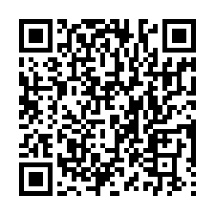

<p align="center">
  
</p>

<h1 align="center">Cement</h1>

<p align="center">A fast FTP server for your 3DS's SD card 🧱</p>

> The names and the design are a work in progress, nothing here is final yet.

## Use it

1. Install `Cement.cia` from the [latest release](https://github.com/Synaelle/cement/releases/latest),
   or scan this in FBI (Remote Install, then Scan QR Code):

   

2. Open it and connect to the address shown on the top screen (like `192.168.1.10:5000`) with
   any FTP client, or with [**Baguette**](https://github.com/Synaelle/baguette) 🥖

## On the 3DS

L and R switch the bottom screen's tabs:

- **Recent**: the CIAs you sent, and those in `/`, `/cia`, `/cias` and `/fbi`
- **Browse**: every folder of the SD card
- **Settings**: FTP login, FTP server on or off, CIA details on the top screen, screens and auto off

The top screen shows the selected CIA's icon, title and version, and whether it's new or an update.
A installs it (and deletes the file once it's installed), X deletes it.

With no login set, anyone on your Wi-Fi can connect. The login is stored as plain text on the SD
card.

## Baguette

[Baguette](https://github.com/Synaelle/baguette) is the Windows app made for Cement. It shows
transfer progress and the 3DS battery, installs CIAs from the PC and sends many small files much
faster. Cement works fine with any other FTP client too.

## Build

On Linux or WSL, with devkitPro (or Docker), `makerom`, `bannertool` and libclang:

```sh
rustup toolchain install nightly -c rust-src
cargo install --locked cargo-3ds
./build.sh
```

`cargo build --release` makes a PC version for tests, where the SD card is a folder.

## Credits

Fonts: [Fredoka](https://github.com/hafontia/Fredoka-One) and
[Nunito](https://github.com/googlefonts/nunito) (SIL Open Font License). Button glyphs:
[Input Prompts](https://kenney.nl/assets/input-prompts) by Kenney (CC0).

## License

GPL-3.0 or later, see [LICENSE](LICENSE). The CIA installer follows
[FBI](https://github.com/Steveice10/FBI) (MIT), see [NOTICE](NOTICE).
