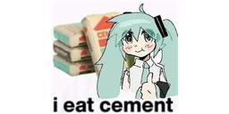
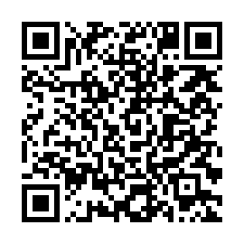

<p align="center">
  
</p>

<h1 align="center">Cement</h1>

<p align="center">FTP server, file browser and CIA installer for your 3DS</p>

## Use it

Install `Cement.cia` from the [latest release](https://github.com/Synaelle/cement/releases/latest), or
scan this in FBI (Remote Install, then Scan QR Code).



Open it and connect to the address on the top screen (like `192.168.1.10:5000`) with any FTP client,
or with [Baguette](https://github.com/Synaelle/baguette), the PC app made for it. Baguette shows
progress and the battery, installs CIAs from the PC, sends many small files faster and keeps its
colour in sync with Cement.

## On the 3DS

L and R switch tabs. Recent lists the CIAs you sent and those in `/`, `/cia`, `/cias` and `/fbi`.
Browse opens any folder and shows PNG, JPEG and BMP images. Settings holds the FTP login, the
looks, auto off and updates, and the top screen explains each one.

A installs the selected CIA and deletes the file afterwards. A reinstall, a downgrade or a system
title needs A twice, and a PC can't install system titles. X deletes a file or folder when pressed
twice, except the important 3DS files while their protection is on.

With no login set, anyone on your Wi-Fi can connect. Only a salted hash of the password is kept.

## Build

On Linux or WSL, with devkitPro (or Docker), `makerom`, `bannertool` and libclang:

```sh
rustup toolchain install nightly-2026-11-09 -c rust-src
cargo install --locked cargo-3ds --version 0.1.5
./build.sh
```

`./build.sh fast` builds quicker to try a change.

## Contributing

Contributions are welcome if they stay within what Cement is for and don't break the SITE commands
Baguette uses (a change to them needs a new protocol level). Open an issue first for anything big.

## Credits

The fonts are [Fredoka](https://github.com/hafontia/Fredoka-One),
[Nunito](https://github.com/googlefonts/nunito) and
[Hanken Grotesk](https://github.com/marcologous/hanken-grotesk) (SIL Open Font License), and the
button glyphs are Kenney's [Input Prompts](https://kenney.nl/assets/input-prompts) (CC0).

## License

AGPL-3.0 or later, see [LICENSE](LICENSE). The CIA installer follows
[FBI](https://github.com/Steveice10/FBI) (MIT), see [NOTICE](NOTICE).
