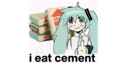

<p align="center">
  
</p>

<h1 align="center">Cement</h1>

<p align="center">A tiny, fast FTP server for your 3DS's SD card 🧱</p>

## What it does

- 📂 **Serves the SD card** over Wi-Fi with plain FTP (and only the SD card)
- ⚡ **Fast uploads**: the SD card writes while the next data is still arriving
- 📦 **Installs CIAs** you send it: pick one on the bottom screen, press A
- 🔋 **Easy on the battery**: close the lid to sleep, screens turn off when idle,
  transfers wait when the battery is nearly empty
- 📊 **Shows** its IP, transfers, SD space and battery on the top screen

## Use it

1. Install `Cement.cia` (or put `Cement.3dsx` in `/3ds/` for the Homebrew Launcher)
2. Open it: the top screen shows the address, like `192.168.1.10` port `5000`
3. Connect with any FTP client (FileZilla, WinSCP...), or with
   [**Chomp**](https://github.com/Synaelle/chomp) 🍪

## Chomp + Cement

[Chomp](https://github.com/Synaelle/chomp) is the Windows app made for Cement: an explorer
with drag and drop, resumable transfers, Send to PC, and a command line for scripts. It
uses a few extras Cement adds to FTP (`SITE STATUS`, `SITE BATCH`) to show progress, time
left, free space and the battery. Cement works fine without it, with any FTP client.

## Build

Cement is written in Rust ([ctru-rs](https://github.com/rust3ds/ctru-rs) over libctru).
On Linux or WSL:

```sh
rustup toolchain install nightly -c rust-src
cargo install --locked cargo-3ds
./build.sh
```

You also need `makerom`, `bannertool` and libclang, plus devkitPro or Docker (the script
copies devkitARM out of the official image). `cargo build --release` instead makes a PC
version that plays the 3DS (the SD card is a folder), handy for tests.

## License

MIT, like [FBI](https://github.com/Steveice10/FBI), whose install steps Cement follows.
See [LICENSE](LICENSE) and [NOTICE](NOTICE).
